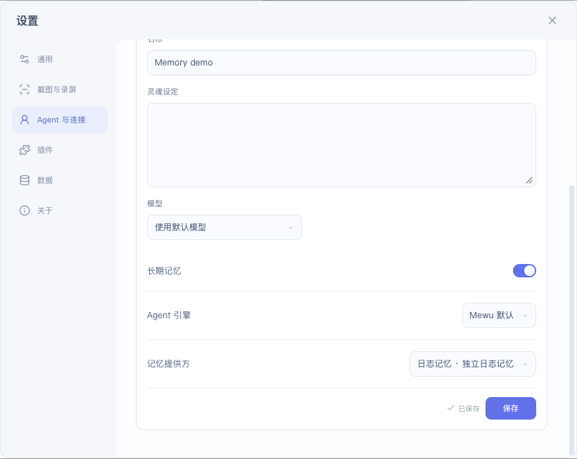

# 独立日志记忆

为 Agent 提供 retain、recall、forget；每条记录独立持久化，按 Agent 隔离并分页检索，不限制为固定总条数。

在 Agent 设置中选择日志记忆提供者。当前检索使用关键词匹配，并非向量检索或自动知识图谱。

## 安装与开发

在 Mewu 的插件市场搜索 **独立日志记忆**，核对本项目源码后安装。已有版本的发行资产保留在[社区市场发行页](https://github.com/abnste/mewu-plugins/releases)，不变更用户现有的更新来源。

本仓库根目录的 mewu-plugin.json 与 index.mjs 是可独立打包的完整插件源码，无须修改 Mewu 核心。[SDK](https://github.com/abnste/mewu_ai/tree/next/packages/sdk) · [打包与 GitHub 投稿](https://github.com/abnste/mewu_ai/tree/next/tools/extension-market)

## 实际效果

下图来自 macOS 上的 Mewu 原生设置窗口（宿主源码 `fb30943c`，插件 `0.1.0`）。插件通过实际 GitHub 市场安装；`Memory demo` 的长期记忆已开启，记忆提供方已保存为“日志记忆 · 独立日志记忆”。验证范围为实际安装与配置保存。

截图仅裁切设置窗口，保留原始像素，没有缩放、重绘或合成。

## 许可

MPL-2.0，与 Mewu 一致。
